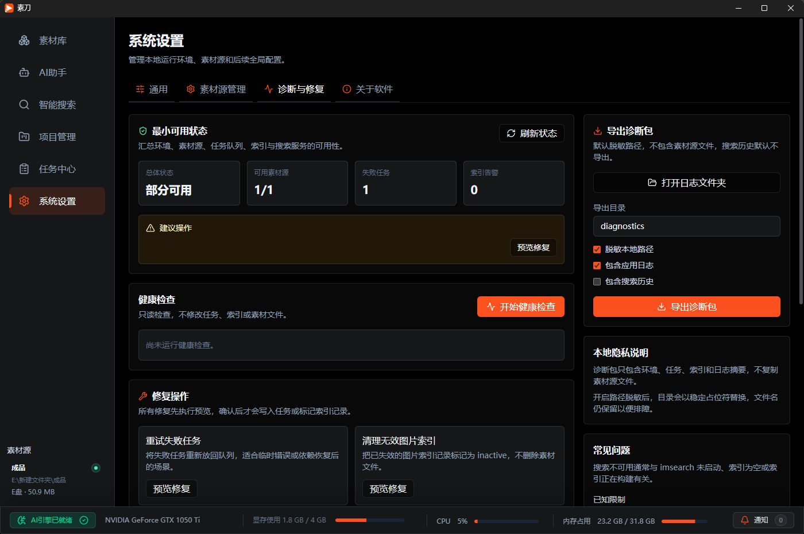
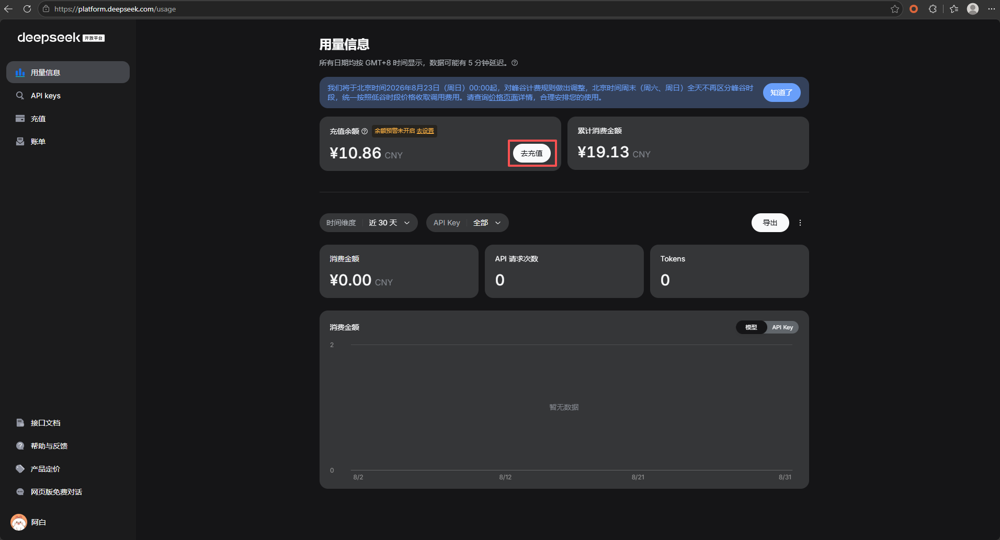
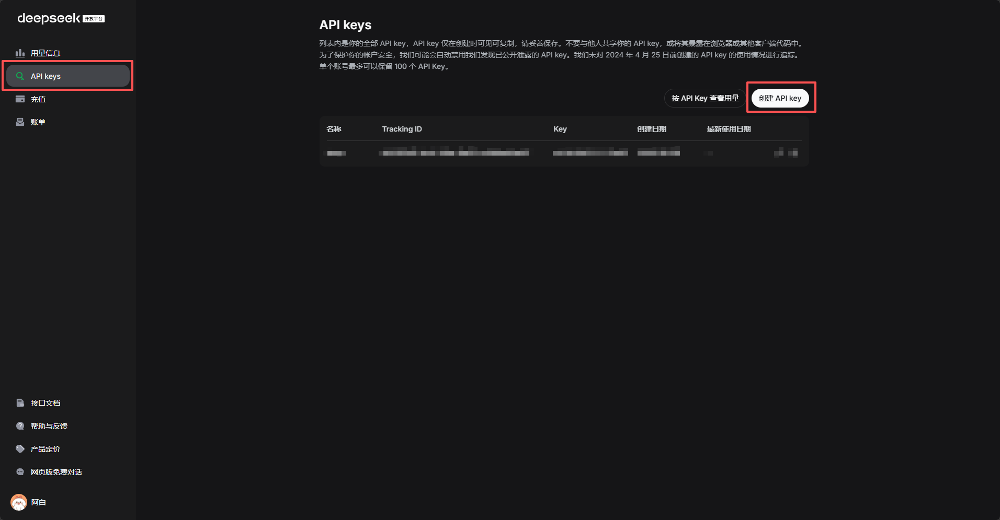
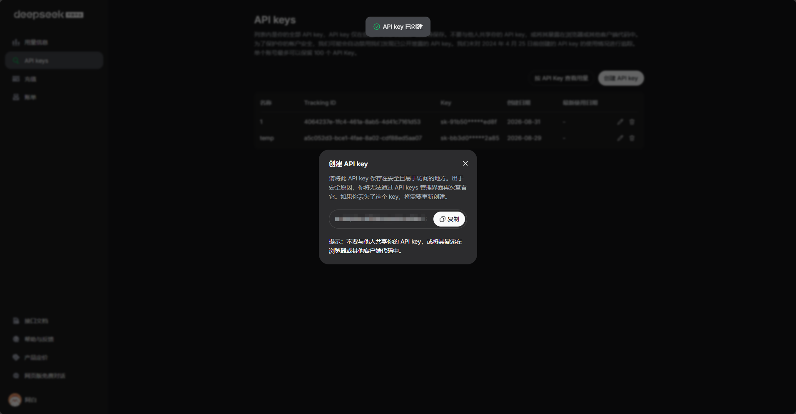
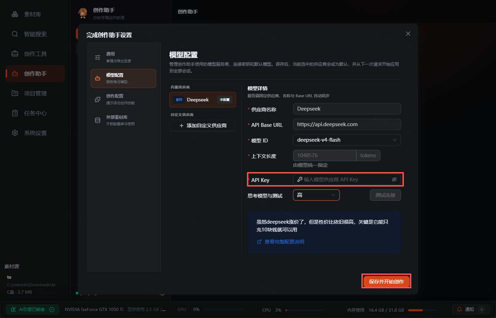

# 素刀 常见问题

更新时间：2026-10-22
适用范围：Windows x64，v2.5.0；需要配套组件的能力以该版本发布清单为准

## ClipKnife 需要联网吗？

核心素材处理以本地环境为主。素材扫描、索引、搜索、视频分镜、代表帧抽取、语音转写和工具箱内容处理都围绕本机运行。

联网能力主要用于辅助功能，例如检查更新、拉取通知、标记通知已读，以及首次启用语音转写时按需下载固定的 Qwen3-ASR/Aligner 资源。安装完成后的转写、词级对齐和索引在本机运行，远程服务不承担本地素材内容处理职责。

## 我的素材会被上传吗？

本机建库、搜索、分镜或转写不会向素刀公网服务上传原始素材。素材文件保存在用户电脑中，诊断包也默认不复制素材源文件。

诊断包只用于问题排查，默认脱敏路径，不包含用户素材源文件，搜索历史默认不导出。

主动启用局域网共享并配对后，搜索词会发送给你选定的共享端；使用共享库的“以图搜图”时，你主动选择的查询图片也会发送至该共享端，临时查询文件在处理结束后清理。共享端会向已授权设备提供所选素材源的搜索结果、分镜、字幕、缩略图、预览和按需下载的原文件。这些数据在局域网设备间传输，不经素刀公网服务中转。共享默认关闭，可随时关闭或撤销设备连接。

## NAS 素材是否需要每台电脑重复建库？

提供“局域网共享”设置页的版本可以由一台运行素刀的电脑维护 NAS 目录索引，其他电脑配对连接后直接查询共享端，无需复制索引或重复建库。首次初始化可选择“仅使用共享素材库”，跳过本机 AI 安装和建库；正常激活仍然需要完成。旧版安装包是否包含此入口，请以对应版本说明为准。

两端已经访问同一个 NAS 时可配置路径映射；文件相对路径、大小和修改时间匹配后直接使用映射文件。不匹配或不可访问时从共享端传输。共享端必须保持运行且能够访问该目录。

## 不用 NAS，能相互共享各自电脑上的素材吗？

可以。每台素刀都可以发布指定素材源并连接其他电脑的共享库。本机目录、外接盘和 NAS 均可使用；没有路径映射时，通过素刀按需提供只读预览与原文件下载，不要求先设置系统文件共享。智能搜索每次选择一个素材库，当前不合并多个共享库结果。

## 共享搜索的筛选项或视频分镜详情为什么不可用？

支持完整共享搜索的版本使用与本机相同的搜索界面、筛选项和视频详情布局。点击共享视频可定位命中时间并浏览分镜；标签、备注、画面描述和字幕以只读方式显示，不能修改或导出对方的分镜。上传图片搜索、指定视频列表和分镜详情还需要共享端支持；本版要求共享双方升级到新版素刀并重新配对，不连接旧版共享端。若详情为空，请在共享端检查该视频是否已建立分镜索引。

## 为什么测试配对成功后，列表里还没有素材源？

“测试配对”只验证连接并获取共享目录。点击“下一步”，设置可选映射后点击“保存”，才会添加到列表。测试结果有效 10 分钟；取消、关闭弹窗或修改连接信息后，需要重新测试。

## 局域网共享是否加密？升级后需要重新设置吗？

本版使用 HTTP 明文传输，连接配置和访问凭据在本机明文保存，仅适用于可信局域网。共享双方需要同时升级并重新配对。旧版加密配置原样保留，不再解密；确认“重新配置共享”后需要重新选择发布目录、添加连接和设置映射，原始素材、索引和下载副本保留。

## 清理共享素材下载会删除 NAS 或对方电脑的文件吗？

不会。在“系统设置 → 局域网共享”点击素材源行，在编辑弹窗的“更多操作”中点击“清理下载副本”，只取消该共享库的未完成下载并删除素刀数据目录内保存的副本，保留 NAS 映射目录和对方原始素材。移除连接不会自动删除已有副本，释放空间时可以先清理再移除连接。

## 支持哪些素材类型？

当前素材库支持图片、视频和音频。相机 RAW 图片支持 DNG、CRW、CR2、CR3、NEF、NRW、ARW、SRF、SR2、RAF、ORF、RW2、RWL、PEF、PTX、SRW；通用 `.raw` 扩展名不在支持范围内。具体相机型号能否解码取决于应用内置 LibRaw 的支持范围。

图片会直接进入视觉检索索引。视频会先分镜，再抽取分镜代表帧进入视觉检索索引。音频会转写成文本后进入语音检索索引。开启视频语音转写后，视频里的语音内容也可以参与语音搜索。

RAW 的缩略图、全屏预览和索引图像都在本机生成，优先使用文件内嵌预览，必要时再解码传感器数据，不会修改原始文件。升级后不会自动重扫已有素材源；再次执行素材源扫描即可发现原有 RAW 文件，后续新增或修改的文件也会由监听发现。

## 素刀的本地 AI 需要什么样的硬件？

运行内存至少需要 16GB。基础图像检索与本地视觉描述不是同一功能：基础图像检索可以使用 CPU；MiniCPM-V 4.6 本地视觉描述需要兼容的 NVIDIA 显卡，至少 4GB 显存、推荐 6GB，不提供 CPU 推理。语音转写按其单独的后端和自检要求启用，不能把视觉描述的显卡门槛套到全部功能。

## 可以添加整个盘符或外接硬盘吗？

可以。素材源可以是普通文件夹、整个盘符或外接硬盘路径。

添加盘符级或范围较大的素材源时，ClipKnife 会执行预检，并建议使用排除规则，避免扫描系统目录、缓存目录、开发依赖目录和 ClipKnife 自身工作目录。

## 移除素材源会删除原始文件吗？

不会。移除素材源只会移除 ClipKnife 对该范围的管理，不代表删除原始素材文件。

同样，从项目中移除素材也只影响项目本身，不会删除原始素材文件。

## 手动添加的单个文件会一直监听吗？

当前开发版（尚未发布）将独立添加的文件作为一次性导入，不持续监听文件或同名字幕。需要更新时重新选择文件添加即可。已经属于监听文件夹的文件仍由文件夹统一监听。

## 从素材库移除与永久删除原文件有什么区别？

这两项属于当前开发版功能，尚未发布。“从素材库移除”保留原文件，只清理该素材的应用记录和索引等数据；监听、重扫或重启不会自动将它加回，清理完成后可以主动重新添加文件。

“永久删除原文件”会删除所选原文件，不经过回收站。操作分两步确认，需核对完整路径、输入完整文件名并勾选不可恢复说明，每次只处理一个文件，不连带删除目录、字幕或导出文件。目前仅支持能够验证身份的 Windows 本地 NTFS/ReFS 磁盘中的普通文件，不支持对共享素材执行此操作。文件变化、占用或权限不足会拒绝删除；中断后不会自动再次删除原文件，结果不确定时会要求核对，清理未完成时可单独重试清理。

## 建库后可以把素刀的数据搬到其他盘吗？

可以。在“系统设置 → 数据与备份”选择“迁移应用数据目录”，再选其他本地固定磁盘上的空目录。数据库、组件、索引、缓存、项目和日志会一起迁移。复制校验期间可以查看进度并取消；确认切换后应用会重启，验证新目录可用且确认旧目录内容未变化后才尝试清理。无法安全确认或清理失败时会保留旧目录。原始素材仍在原素材源，不会被移动。独立放在旧根目录之外的组件目录会保留。

## 为什么刚添加素材后搜索不到？

新版简化初始化为待发布功能：它允许先选择少量视频或图片，自动准备环境后边处理边搜索。“等不及了，开始搜索”只关闭提示并进入智能搜索，不会停止后台处理。搜索只覆盖已经完成索引的素材；弹窗计数未完成或显示失败的素材不会被伪装成可搜索结果。

素材需要先完成扫描、入库和索引。图片通常直接进入视觉索引；视频需要先分镜、抽取代表帧，再建立索引；音频需要生成转写后才能参与语音搜索。

如果刚添加素材就搜索不到，可以先到任务中心查看是否还有等待中、处理中或失败任务。

## 新版初始化必须先选文件夹吗？

不需要。新版简化初始化（待发布）直接选择视频或图片文件，加入“单独添加的文件”，不移动原素材，也不扫描同目录的其他文件。页面建议 2～3 个视频或 100 张图片，并非硬性上限。需要文件夹、素材盘、仅使用共享库或从备份恢复时，点击首屏左上角“高级初始化”继续原有流程。

## 新版初始化安装失败，需要重新选择素材吗？

一般不需要。文件选择和数据位置保存在本机，重新打开可接着准备环境。失败页可重试或返回修改位置；重试复用已成功安装的有效组件，缺少组件时仍执行正常下载与完整性校验。若素材已被移动、删除或外接盘已断开，请先恢复文件或重新选择。

## 智能搜索和素材库搜索有什么区别？

素材库搜索主要搜索文件名、路径和标签等元信息。

智能搜索使用自然语言检索图片、视频片段和音频/视频语音内容。比如你可以输入“海边日落”“红色包装特写”或“会议里提到预算调整”。

智能搜索的文字匹配使用独立标题、标签、描述、字幕、语音转写和已提取的画面文字，连续命中两个汉字也可以进入候选。文件名和路径不参与内容匹配及相关性排序，按名称找文件请使用素材库搜索。

## 为什么提示“文本索引正在升级”？

应用正在把旧文本索引升级为仅按内容匹配，避免文件名命中挤占描述或语音结果。升级期间，已完成的内容可以搜索，未完成部分暂不参与文本检索，画面搜索仍可使用。

在任务中心查看“文本索引补建”进度，可以暂停、继续或在失败后重试。升级使用已有文本，不会重新转写、生成画面描述或修改原始素材；重启后会继续保存的进度。

## 为什么提示“部分标签仍在同步”？

标签已保存在本地，但本地搜索索引还没有处理完最新更新，因此当前结果可能暂未包含最新标签。扫描、索引、导出等其他可运行任务期间，标签同步会等待队列空闲。这不是云同步，也不会上传原始素材。

点击搜索提示旁的“查看标签同步任务”，可以查看等待状态、已同步数量和失败原因。服务繁忙或写入失败时会自动延后重试；连续失败后，请检查本地 AI 组件并在任务中心使用“重试失败”。如果同步任务被人工暂停，可以单独继续或点击“全部开始”；如果索引尚未就绪，需要等待索引建立。应用重启后会恢复中断的同步任务，但保留人工暂停状态；清理任务记录不会删除已保存的标签。

## 点击“全部暂停”后，新任务还会执行吗？

会。“全部暂停”只影响本次操作时已有的可暂停任务，队列继续运行，之后新增的任务仍会正常排队执行。“全部开始”恢复所有人工暂停且具备执行条件的任务，包括此前单独暂停的任务。资源缺失或索引检查等限制仍需先处理；已提交到剪映或 Premiere、正在确认结果的任务暂不能中断，批量暂停会提示数量。

## 搜索没有结果怎么办？

可以按这个顺序检查：

1. 换一个更具体的描述。
2. 确认当前搜索模式没有限制过窄。
3. 查看任务中心，确认索引任务是否完成。
4. 检查素材源是否仍可访问。
5. 前往诊断入口检查搜索服务和本地组件状态。

## 以图搜图不能用怎么办？

以图搜图需要当前图片或视频代表帧拥有可用的相似检索索引 ID。如果页面提示无法进行以图搜图，通常说明相关索引缺失、失败或失效。

你可以先查看任务中心的失败任务，再根据提示重试任务或重新构建 AI 索引。

## 视频搜索是搜索整个视频吗？

视频视觉搜索主要基于分镜代表帧。ClipKnife 会把视频切分成分镜，再抽取代表帧进入视觉索引。搜索结果会回连到原视频和对应时间段。

这意味着 ClipKnife 不承诺自动理解完整视频语义，搜索质量会依赖分镜和代表帧索引质量。

## 可以搜索视频里的说话内容吗？

可以，但需要开启视频语音转写。音频和视频语音转写是两个独立开关，默认均关闭；开启对应开关后，才会为该类素材生成语音转写任务。

开启后，视频中的语音内容可以进入语音检索索引，搜索结果仍会保留视频身份，方便回到视频上下文。

## 为什么首次开启语音转写需要下载模型？

素刀安装包不预装语音权重。首次开启音频或视频语音转写时，会先展示本机后端、时间戳精度、准确下载量、磁盘和显存要求；只有你确认且下载、SHA-256 校验和本机自检全部成功后，开关才会打开。取消或失败会保持关闭。

当前固定使用 `Qwen3-ASR-0.6B Q8_0`。近似模式只需要 ASR；精确词级时间戳还需要按需下载 `Qwen3-ForcedAligner-0.6B Q8_0`。模型安装后在本机处理音视频，不会因为转写把原始素材或转写文本上传给素刀远程服务。

## 6 GB 显卡可以使用精确词级时间戳吗？

有机会，但不是默认保证。6～8 GB 的兼容显卡默认使用近似段级时间戳；你可以主动选择“实验性精确时间戳”，素刀会依次运行 ASR 与 Aligner 做本机显存自检。通过后才保存精确模式；失败时会明确提示改用近似模式，不会静默降级。

兼容且总显存至少 8 GB 的显卡默认提供精确模式。系统或驱动因保留区而报告略低于标称容量时，素刀会按容量档识别，运行预算和本机自检仍使用实际报告值。精确模式不会让 ASR 与 Aligner 同时常驻：显存充足且通过共驻留自检时，imsearch 保持驻留，语音运行时按 ASR → 卸载 ASR → Aligner 的顺序处理；共驻留显存不足时，素刀会先完成当前 imsearch 工作并卸载其模型，再按 ASR → Aligner → 恢复 imsearch 的顺序处理。任一单独阶段仍放不下时任务会等待显存并允许取消。没有兼容 GPU 时，系统内存至少 16 GB 才提供 CPU 近似模式，且不承诺实时速度。

## 关闭语音转写会删除模型或历史索引吗？

不会。关闭开关只停止或取消对应的新转写任务，已下载模型和已有有效索引会保留。只有明确点击“删除语音模型”时，素刀才会先关闭音频与视频转写、停止语音运行时，并删除应用专属的 ASR/Aligner 目录；不会扫描或删除其他软件的模型缓存。

## 分镜编辑会修改原始视频吗？

不会。当前可用编辑仅限分镜标签，修改标签不会改变原始视频内容。当前视频详情不提供备注、起止时间调整、合并、拆分或删除分镜操作。

导出片段会生成新的输出文件，便于后续剪辑或归档。工具箱“批量视频拆分镜”用于自动识别并导出全部镜头，与视频详情的标签编辑是不同功能。

## 如何一键添加分镜到 Adobe Premiere Pro（PR）？

v2.4.0 已提供“添加到 → Adobe Premiere Pro”菜单，需要配套的“素刀连接”0.2.0 或更新插件。支持 Windows Premiere Pro 26.0 及以上，当前已在 26.0.0 实机验证，其他 PR 版本尚未逐版验证；首版不支持 PR 25.x 和 macOS。功能与升级说明见 [v2.4.0 更新日志](../changelog/v2.4.0/)。

首次使用需要准备插件，之后不需要复制、粘贴配对信息：

1. 按下方安装说明安装或加载“素刀连接”插件，并打开配套版本的素刀。
2. 在 PR 中打开项目和目标序列，点击该序列的时间线，使它成为当前活动序列。
3. 在 PR 的“窗口 → UXP 插件”中打开“素刀连接”，等待面板显示“已连接”，并保持面板打开。
4. 在素刀的视频分镜列表或本地搜索结果中，对需要的分镜右键，选择“添加到 → Adobe Premiere Pro”。
5. 到素刀任务中心查看结果，再到 PR 当前序列末尾查看新增片段；可以直接播放、剪辑或调整片段边缘。

每次操作添加右键所在的一项素材，使用新增轨道追加到当前活动序列末尾，保留已有片段的位置。暂不支持选择播放头位置插入、批量添加或自动新建项目与序列。

同一个菜单也支持本地完整视频和图片：完整视频使用原文件，图片默认约 3 秒，实际时长按序列帧率对齐。首版不支持单独添加音频或直接添加局域网共享库素材。

## 添加到 PR 的分镜还能左右拉长吗？

可以在原视频范围内调整。素刀将完整原视频和分镜起止范围交给 PR，不会先导出一个裁短的视频文件。添加后，在 PR 时间线上拖动片段的左、右边缘，即可继续缩短或延长。

例如，原视频长 24 秒，添加其中第 4–10 秒的分镜后，可以把左边缘向前拉到第 3 秒、右边缘向后拉到第 11 秒。已经到达原视频开头或结尾的一侧不能继续向外延长；拖动时还需遵循 PR 的轨道与相邻片段规则。

这不会修改原始文件，也不改变素刀中的分镜范围。可以在 PR 中用 Ctrl+Z 撤销刚添加的片段，用 Ctrl+Shift+Z 重做。PR 仍然引用原素材，后续若移动、删除文件或断开素材所在硬盘，需要在 PR 中重新链接媒体。

## “素刀连接”PR 插件如何安装？双击 CCX 没有反应怎么办？

插件文件名为 `ClipKnife-Premiere.ccx`，需要与提供该功能的素刀版本配套使用。正常安装由 Adobe Creative Cloud 桌面应用处理：

1. 安装并打开 Adobe Creative Cloud 桌面应用，确认本机已安装受支持的 Premiere Pro。
2. 双击 `ClipKnife-Premiere.ccx`，按 Adobe 安装窗口提示完成安装。
3. 回到 PR，在“窗口 → UXP 插件”中打开“素刀连接”；若菜单尚未刷新，先保存项目，再重启 PR。
4. 打开素刀和目标序列，等待自动连接。正常 CCX 安装不需要 VBS，也不需要开启 PR 开发者模式。

双击没有反应时，先检查 Creative Cloud 桌面应用和 CCX 文件关联。可按 [Adobe 官方插件安装说明](https://developer.adobe.com/premiere-pro/uxp/plugins/distribution/install/) 排查；已有 Adobe UPIA 工具的用户，也可参考 [官方手动安装步骤](https://helpx.adobe.com/creative-cloud/apps/integration-with-other-apps/manage-plugins/install-plugins-using-upia-tool.html)。

当前实机验证使用开发加载方式；正常 CCX 安装及关闭开发者模式后的重启连接尚待验收。插件下载与支持范围以配套测试包或正式发布说明为准。

## 可以用 VBS 加载 PR 插件吗？

VBS 是 Windows 开发测试的加载入口，不是插件安装包。当前的 `加载素刀到PR.vbs` 依赖配套脚本、插件目录、Node.js 和 Adobe 开发工具，还包含本机环境配置；不能只把 VBS 或“VBS + CCX”复制到另一台电脑就使用。

在已配置好的测试环境中，先在 PR 的“编辑 → 首选项 → 插件”开启“开发者模式”，按提示重启 PR，再双击加载脚本。加载成功后打开“窗口 → UXP 插件 → 素刀连接”，保持面板打开，即可按前面的步骤自动连接和添加分镜。若重启 PR 后插件未加载，需要重新运行加载脚本。

需要在其他电脑使用开发加载时，应取得适配该电脑的完整工具与插件环境，并按随包说明操作；当前尚未提供可独立分发的便携加载包。普通安装请使用上面的 CCX 方式。

## PR 没有连接，或者添加结果未确认怎么办？

可以按以下顺序检查：

1. 素刀和插件是否为配套版本，右键菜单是否包含“Adobe Premiere Pro”；旧插件若仍要求粘贴配对信息，需要更新。
2. PR 是否已打开项目与目标序列，“素刀连接”面板是否保持打开；仅启动 PR 主窗口还不够。
3. 在素刀“系统设置 → 剪辑软件”检查连接状态，按当前状态启用或重新连接。如果曾在 PR 插件面板暂停连接，还需在面板点击“重新连接”。
4. 只保留需要操作的 PR 实例，并确认原素材文件仍可访问、素材所在硬盘已连接。

素刀服务重启后，保持面板打开可自动重新连接。若任务提示“尚未确认添加结果”，请先检查 PR 时间线末尾是否已经出现片段，再决定是否重新添加，避免重复；连接恢复不会自动重做一次剪辑操作。排查失败时，可提供素刀版本、PR 版本、插件版本和任务中心的错误提示。

## 开发版把项目改为分组后，旧数据怎么办？

以下为尚未发布的开发版变更：每个旧项目会迁入“智能分类 → 我的分组”，默认是手动分组，不自动生成候选。名称、描述和成员继续保留，重名时追加“（原项目）”及序号。迁移中断后可续迁，不重复创建分组；离线素材和失效分镜保留记录并提示状态。

右键选中分组后立即添加，重复添加不会重复计数。分组支持图片、完整视频、音频和分镜引用，不再自动导出项目片段。迁移、移出成员及删除分组都不会清理原始素材或旧项目导出文件。删除分组需要确认，删除后重启不会重新迁入同一项目。

## 项目删除会影响原始素材吗？

以下说明适用于已发布的 v2.5.0 项目管理。

删除项目会删除项目记录和项目文件夹中的导出内容，操作不可撤销。但原始素材文件不会因此被删除。

从项目中移除素材只影响当前项目。移除分镜会删除项目内生成的分镜文件，原始视频不会被删除。

## 外接硬盘断开后会怎样？

如果外接盘断开或路径失效，ClipKnife 会提示素材源异常。这个异常不应影响其他可用素材源继续工作。

重新连接外接盘后，如果盘符或路径发生变化，建议检查素材源状态，并根据需要重新扫描或修复。

## 任务失败怎么办？

先进入任务中心查看失败原因。常见处理方式包括：

- 修复或恢复源文件。
- 重新连接外接盘。
- 重试失败任务。
- 重新建库。
- 前往诊断与修复检查本地组件。

诊断与修复中的操作会先预览影响范围。重试范围变化时需要重新预览；完整重建会重新处理素材并生成新索引。请先恢复不可访问的素材源。

索引差异修复和压缩会进入任务中心。排队代表尚未完成；如果队列已暂停，需要在任务中心恢复。压缩收到停止请求后，会等待当前步骤结束再停止。

## 诊断包里有什么？

诊断包用于问题排查，默认只包含环境、任务、索引和日志摘要。它默认脱敏路径，不复制素材源文件，搜索历史默认不导出。

如果需要把诊断包提供给作者或支持人员，建议先确认页面提示的导出范围。

## 支持云同步、账号或多人协作吗？

当前不包含账号系统、云同步、多人协作、素材交易市场和商业化付费逻辑。创作助手可以按需检索第三方开放素材来源，但这不等同于素刀提供在线素材市场。

ClipKnife 当前重点是本地素材管理、本地 AI 索引、自然语言搜索、分镜、语音转写、项目、创作助手、本地工具箱和诊断维护。

## 检查更新有什么作用？

系统设置提供检查更新入口。ClipKnife 可以检查 stable 发布渠道中的最新版本。每个版本统一使用一个 Windows 安装包；查看更新说明后，点击一次“立即更新”即可继续，无需再手动打开 NSIS 安装包。

如果当前版本落后多个已发布版本，更新提示会按版本从新到旧列出期间所有更新说明，避免遗漏中间版本内容。

检查更新也会比较 imsearch 与 TransNetV2 的本机版本和目标软件版本。v2.5.0 先准备并校验所需文件，再在安装阶段替换组件和交接软件安装包；准备期间不替换正在运行的组件。组件校验或安装失败会阻止后续安装，并按恢复记录处理。安装包下载完成前可以取消，NSIS 安装程序启动后不能再由应用取消。

如果当前版本本身还不包含自动更新器，需要先手动下载安装一次新版。完成这次引导升级后，后续版本即可使用自动更新。

## 能否在后台下载，下次启动时再更新？

v2.5.0 已支持，升级至该版本后生效。“系统设置 → 关于软件”的更新区域提供“自动更新”开关、说明和当前状态，默认开启。发现新更新时仍弹出更新提示，弹窗只提供手动更新等操作，没有自动更新开关或暂停、继续、重试等自动更新按钮。弹窗打开期间不启动自动下载；关闭弹窗后，只有开关开启时才在后台准备安装包和必需组件。

检查版本时只读取版本、更新清单和组件元数据，不提前扫描完整模型和运行库。下载后会在后台校验文件和运行库；如果小包需要复用的运行库损坏，会自动补下载并验证基础包。期间可以继续使用素刀，设置中会区分“自动更新”和“手动更新”，显示当前阶段、可计算的进度及最终结果。“检查版本”和“校验更新文件”是不同阶段；正常的版本检查不代替组件故障后的主动检查或修复。

下载和后台校验都完成后，等待下次启动素刀时安装，不会主动重启。退出应用后停止下载，从托盘恢复窗口不会触发安装。关闭自动更新开关会停止自动下载，并阻止下次自动安装；手动“立即更新”仍可使用，会复用同一个下载任务和已校验文件，准备完成后安全重启安装。关闭开关或更新弹窗都不会取消已经主动发起的手动更新；安装程序启动后不能再由素刀取消。

安装前仍需短暂联网确认发布是否有效，在线复核最多等待 10 秒。断网或超时会继续启动现有版本；签名、哈希校验失败或发布撤回时不会安装。可选工具和语音、视觉模型不包含在自动下载范围内，仅使用共享素材库时也不会补装本地 AI 组件。

## 为什么手动更新下载完成后还需要安装和重启？

下载校验完成只表示文件已准备好，仍需替换组件、运行安装器并检查新版本。启动页会持续标注“手动更新”，安装器再次重启也属于同一次任务，不会转入自动下载。手动下载中断或失败后保留可复用缓存，等待手动重试；成功后显示完成状态，本次启动不紧接着检查另一轮更新。自动更新则在后台准备好后等待下次普通启动安装，不主动重启当前会话。

组件健康检查会使用独立临时索引验证组件和模型。原搜索索引需要恢复时，仍执行正常恢复流程，不会把索引待恢复直接判成组件安装失败，也不会清空原索引。

## 创作助手
### 创作助手能做什么？

创作助手提供“智能口播”和“通用专家”入口。“智能口播”衔接文案、分段配音、画面匹配与草稿组装；“通用专家”处理素材检索、媒体分析和自由剪辑。每个会话创建时确定专家，旧版未标注专家的历史会话归入通用专家。两者都交付可继续编辑的剪映草稿，不提供成片导出。

它支持添加图片、视频、音频、文字、贴纸、特效和滤镜，也可以调整轨道、时序、动画、转场、蒙版、关键帧、淡入淡出和背景，替换模板素材或文字，导入 SRT 字幕并保存草稿。实际可用范围仍取决于模型、素材、工具状态和本机剪映环境。

### 使用创作助手前需要准备什么？

先在“创作助手设置”中确认剪映草稿目录，再配置并测试一个模型供应商。助手不需要设置成片导出目录。选择专家后再提交任务；建议同时说明用途、时长、画幅、素材范围、文案语气和期望输出，也可以选择现有草稿或附加本地文件。

没有指定现有草稿时，创作助手会创建不重名的新草稿；只有明确选择或点名现有草稿时才会编辑它。删除草稿始终需要明确批准。

### 自动模式和询问模式有什么区别？

自动模式会连续完成常规步骤，不逐项询问；智能口播不会停在文案和分镜确认点。是否使用外部素材由全局设置和会话开关控制。

询问模式会在关键信息不足时集中确认。智能口播保留文案和分镜两个确认点，可以预览配音与候选画面后再继续；修改文案时只重做受影响部分，更换画面时保留已有配音。永久删除草稿仍需要明确批准。

### 创作助手可以使用哪些外部素材？

在“创作助手设置 → 外部素材库”中，通过“使用外部素材库”开关控制，默认关闭。所有未单独设置的会话会持续跟随最新全局配置。你也可以在会话的“素材范围”弹窗中单独开启或关闭，并通过“恢复全局设置”重新跟随全局；点击“保存”后生效，不要求同时选择本地目录。会话设置会在重启后保留。历史会话旧的文字或授权卡决定不再生效，统一跟随全局。

开关开启后，助手可按需检索和下载外部图片、视频及音频，消息中的允许或拒绝不会改变开关。任务运行中也可修改外部开关，保存后从下一次外部请求开始生效；已开始的请求正常结束，已下载素材保留。询问模式仍保留素材选择确认。

开关开启后，创作助手可以搜索 Openverse、Wikimedia Commons、Pexels、Pixabay、Coverr、Jamendo 和 Freesound。部分来源需要在“创作助手设置 → 外部素材库”中填写密钥，密钥只保存在当前设备。

搜索结果会尽量保留来源、作者和许可信息，选中的文件会下载到当前会话工作区。发布作品前仍需自行核对授权条件、署名要求、商用范围和内容合规性。

### 创作助手能直接导出成片吗？

不能。v2.3.0 已移除助手直接导出成片的流程，交付物统一为可继续编辑的剪映草稿。需要视频文件时，请在剪映中检查画面、配音和时间线，再完成导出。助手生成过程中可以停止当前任务；素材片段导出与工具箱批量视频拆分镜是另外的功能，不受这一调整影响。

### 怎样调整专家使用的技能？

在“专家与技能”页面为“智能口播”和“通用专家”配置技能、修改专家专属技能描述或恢复默认，也可以给单次创作附加一个自定义技能。长期流程调整在该页面完成，从下一次运行生效；对话中的助手不再直接修改技能文件。

### 创作助手的模型供应商从哪里来？

“创作助手设置 → 模型配置”左侧的内置供应商由素刀服务端提供，包含供应商名称、API Base URL、模型 ID 选项、每个模型的上下文长度，以及可选的配置说明简介和链接。内置供应商只能选择服务端提供的模型 ID，上下文长度也由服务端按模型设置。你也可以添加自定义供应商并自行输入模型 ID 和上下文长度，但仅支持 OpenAI Compatible 协议；上下文长度默认是 256k（262,144 tokens）。自定义供应商可以在二次确认后删除；历史会话内容仍会保留，但依赖该供应商的会话无法继续对话。暂时离线时会使用同一远程服务最近一次成功获取的供应商目录；没有缓存时仍可使用已有本地配置。

### 创作助手的 API Key 会上传到素刀服务端吗？

不会。素刀服务端只下发供应商的公开配置元数据，API Key 保存在桌面端本地私有配置中。测试连接和实际创作请求会直接访问你配置的模型供应商，请根据该供应商的隐私政策决定是否使用。

### 如何配置DeepSeek
虽然deepseek涨价了，但是性价比依旧最高，关键是它能只充10块钱试试水
1. 1. 打开 deepseek API开放平台 [https://platform.deepseek.com/usage](https://platform.deepseek.com/usage) 
2. 2. 登录你的账号，然后点击 充值, 先充10元就够用一阵子了

3. 3. 拿到API密钥之后 填入到 API密钥中，你的API密钥一定不要告诉其他人

## 工具箱

### 工具箱有哪些工具，为什么需要单独安装？

当前客户端适配了文本转语音、基于 Real-ESRGAN 的图片清晰化、基于 Video2X 的视频分辨率/帧率增强，以及基于内置 TransNetV2 的批量视频拆分镜。工具种类和使用界面需要随客户端版本一起适配，服务端不能动态加入客户端不认识的工具。前三项第三方工具体积较大且更新节奏不同，因此按需下载安装；素刀会在启用前校验压缩包和包内文件。视频拆分镜随应用组件提供，不需要在工具箱另行安装。

### 批量视频拆分镜与素材库自动分镜有什么区别？

素材库自动分镜服务于视频索引与搜索；工具箱中的“批量视频拆分镜”支持拖入或选择多个本地视频，导入后立即排队，使用与素材库相同的默认阈值（当前为 0.5），自动精确导出全部镜头，无需预览或选片。工具详情页右上角的“导出设置”可选择视频同级目录或指定文件夹，并记住选择；只对之后导入的视频生效，已排队任务保持原位置。每个视频仍以文件名去掉扩展名创建子文件夹，分镜文件命名保持不变；同名文件夹或文件已存在时跳过并提示，不覆盖原视频或已有结果。完成后可从任务列表打开保存位置，清空历史会保留所有文件。结果若位于已监听的素材源内，按该素材源的原有规则扫描。

任务列表支持“取消全部”和“重试失败”；失败或已取消的任务也可单独重试。重试会沿用该任务原来的导出位置并更新原记录，后续修改导出设置不会改变它；已有同名结果目录仍会跳过。旧版本历史若缺少重试信息，需要重新导入源视频。

### 能使用本地视觉模型吗？没有 NVIDIA 显卡怎么办？

可在“设置 → 视觉辅助模型”选择本地 MiniCPM-V 4.6。v2.4.0 优先检查匹配的本机离线组件，缺少可用离线包时，经用户确认后再联网下载运行时、CUDA 依赖、模型和投影器。仅支持 Windows x64 与兼容的 NVIDIA 显卡，至少 4GB 显存、推荐 6GB，不提供 CPU 推理；用户无需安装 Python 或完整 CUDA Toolkit。组件是否可下载以该版本的发布清单为准。没有兼容显卡、空闲显存不足或组件未提供时，可使用外部视觉 API。

v2.4.0 的 NVIDIA 搜索与本地视觉组件使用 CUDA 13，要求显卡计算能力至少 7.5、Windows 驱动至少 580.88。GTX 1050 Ti 等 Maxwell、Pascal、Volta 架构显卡无法运行新版本地视觉描述，基础图像检索会回退 CPU。CPU 与 AMD 搜索组件不适用这组 NVIDIA 门槛，语音等其他组件仍按各自要求启用。

本地图片在本机处理，失败不会自动上传；切换外部来源时保留原有服务配置。安装支持进度、取消、自检和失败回滚。本地视觉、图像检索和 CUDA 语音会排队使用显卡，完成描述后恢复图像模型。即使使用本地视觉，创作助手仍可能把生成的描述文字发送给其配置的创作模型。

### 创作助手何时会调用外部视觉模型？

只有你在设置中选择、配置并启用外部视觉 API 后，创作助手才会在需要理解画面时自主调用，不会逐次询问。每次发送一张图片、一个指定时间点的视频帧，或分镜 1/4、1/2、3/4 位置最多三张按时间排列的采样帧给你配置的供应商，不发送完整视频。能够对应现有素材索引的结果会保存到本地视觉描述索引；其他结果只用于当前会话。关闭该设置后不会发起新的外部视觉描述请求。

### 创作助手调用 FFmpeg 会访问任意文件或网络吗？

不会。FFmpeg 只能读取当前会话已经授权的素材或附加文件，输出只能写入当前会话工作区；任意本机路径、URL、网络协议、管道、脚本和可间接加载其他资源的输入会被拒绝。一次任务可以声明并生成多个输出，未完成或未声明的附带文件会被清理，结果不会自动加入素材库。

### 工具安装或更新失败怎么办？

先刷新工具箱并确认网络可访问素刀远程服务，再查看任务中心里的下载、校验或解压错误。没有可安装版本时，需要等待服务端发布与当前客户端适配的版本。不要把来源不明的可执行文件手工复制到工具目录。

### 图片或视频增强为什么无法开始，或者处理很慢？

先确认对应工具已经安装，并检查显卡是否支持 Vulkan。图片清晰化固定放大 4×；TTA、RIFE UHD，以及视频增强中更高的分辨率或帧率倍率和“先提升分辨率，再提升帧率”都会增加显存、磁盘占用和处理时间。可以先用较小的图片或较短的视频和默认模型测试；显存不足时，图片工具可改用较小分块。处理可随时取消，素刀不会覆盖原始图片或视频。

### 文本转语音生成失败后，输入正文会留在任务记录里吗？

不会。任务中心只记录工具、音色、进度、结果文件和错误状态等必要信息，不保存输入正文。从工具详情生成的 WAV 文件会保存在应用管理的工具箱输出目录，可在“最近生成”中试听或在文件夹中显示；从创作助手生成的 WAV 文件会直接保存在对应会话工作区，不会出现在工具箱的“最近生成”列表。
